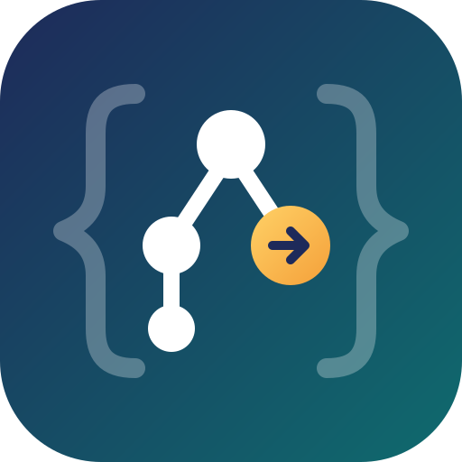
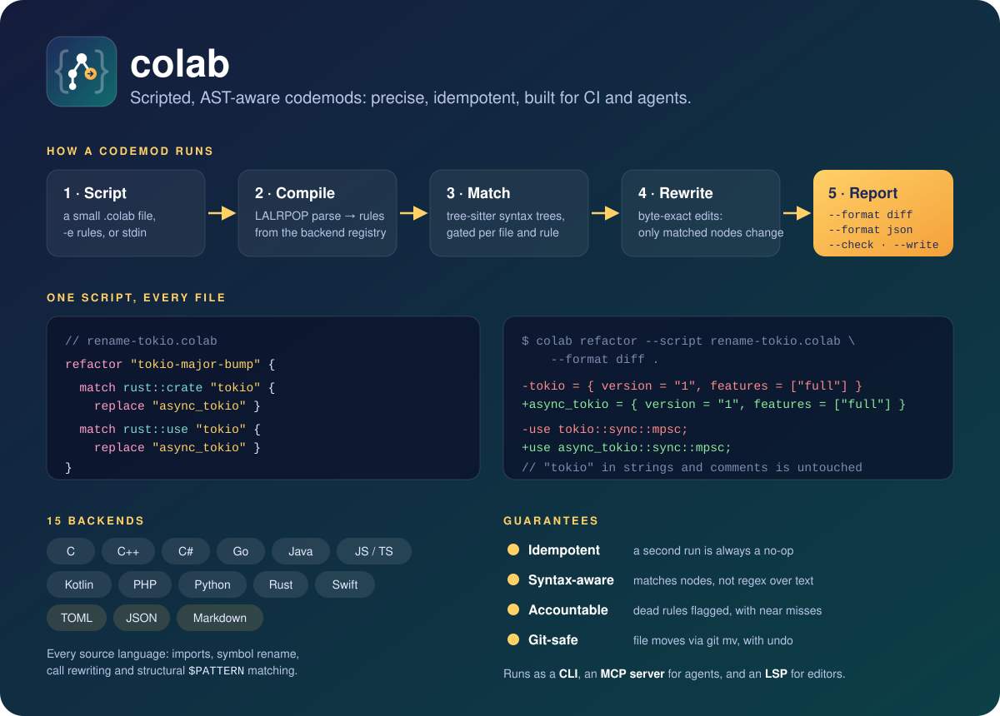

<p align="center">
  
</p>

# Colab (Code Lab)

A scripted, AST-aware code refactoring (codemod) tool. Point it at a
repo, hand it a small `.codemod` script, and it will rewrite source
files deterministically — using tree-sitter for the matching, not
regex — across twelve languages: **C, C++, C#, Go, Java,
JavaScript/TypeScript, Kotlin, PHP, Python, Ruby, Rust, and Swift**. It
also edits **TOML, JSON and Markdown** configuration by key path, JSON
Pointer or managed block, so a repository convention can be rolled out
the same way (see [`examples/config`](examples/config/repo_migration/)).

Agents typically change files with diffs and tools like sed. Colab is a more precise, idempotent and
language-aware alternative: a rule matches syntax, not text, so renaming a call rewrites the call sites and
leaves strings and comments alone. It can rename a crate and all the `use` statements in Rust, or a package and
all the `import` statements in Java, and it delegates scope-aware renames, file moves and IDE refactorings to the
language's own server (`colab rename`, `mv`, `action`).

```sh
colab refactor --script rename-tokio.codemod --check .
```

<p align="center">
  
</p>

## Why

Codebase-wide refactoring lives in an awkward middle ground:

- *sed/grep* is fast and language-agnostic but accidentally rewrites
  string contents and comments.
- IDE refactoring is precise but ties you to one editor and one
  language at a time.
- Hand-rolled scripts work but are write-once.

Colab sits in the middle: a small DSL, syntax-aware matching via
tree-sitter, idempotent operations, and a deterministic CLI that
runs the same way on a developer machine, in CI, and from an AI
agent.

## Capabilities

Twelve languages, each with the same capability floor — an
import-equivalent, a symbol rename, call rewriting, and `pattern`
(match a code shape with `$METAVARS`):

| Language                | Namespace | Modules                                             |
|-------------------------|-----------|-----------------------------------------------------|
| C                       | `c`       | `include`, `symbol`, `call`                         |
| C++                     | `cpp`     | `include`, `namespace`, `symbol`, `call`            |
| C#                      | `csharp`  | `using`, `namespace`, `symbol`, `call`              |
| Go                      | `go`      | `import`, `package`, `symbol`, `struct_tag`, `call` |
| Java                    | `java`    | `import`, `package`, `symbol`, `call`               |
| JavaScript / TypeScript | `js`      | `import`, `symbol`, `call`                          |
| Kotlin                  | `kotlin`  | `import`, `package`, `symbol`, `call`               |
| PHP                     | `php`     | `use`, `namespace`, `symbol`, `call`                |
| Python                  | `python`  | `import`, `symbol`, `call`                          |
| Ruby                    | `ruby`    | `require`, `symbol`, `call`                         |
| Rust                    | `rust`    | `use`, `symbol`, `crate` (Cargo.toml), `call`       |
| Swift                   | `swift`   | `import`, `symbol`, `call`                          |

Every row also has `pattern`. Actions: `replace`, `delete`, `ensure`,
`replace_call` (with `$1`/`$args`/`$func` template placeholders). The
import-equivalent module takes all three of `replace`/`delete`/`ensure`;
`symbol` and the namespace/package modules take `replace`; `call` takes
`replace_call`; `pattern` takes `replace`/`delete`. The config backends
(`json`, `toml`, `markdown`) take `set`/`insert`/`delete`, and Markdown
also `replace`/`ensure`.

Each backend's module is named for the language's own construct, so a
polyglot script reads naturally — see
[`examples/polyglot`](examples/polyglot/) for one script covering six
languages at once.

The full capability matrix lives in [`docs/features.md`](docs/features.md).
At runtime, ask the binary directly:

```sh
colab schema           # full JSON capability schema
colab list-languages   # backends registered in this build
colab list-rules go    # modules and actions for one backend
colab server           # LSP for .codemod files: diagnostics, hover, completion, code actions
colab mcp              # MCP server: 20 tools (preview, apply, find, ast, test_rule, rename, outline, …)
```

## Install

```sh
brew tap grahambrooks/colab https://github.com/grahambrooks/colab
brew install colab                          # Homebrew, macOS and Linux
cargo install --git https://github.com/grahambrooks/colab colab-cli
```

Then put colab in front of your agent: `colab agent install` wires its
MCP server, skill and (Claude Code) post-edit hook into Claude Code,
Cursor or Codex, whichever it finds; `colab agent uninstall` takes it out
again. Claude Code users can install the plugin instead:
`/plugin marketplace add grahambrooks/colab`, `/plugin install colab@colab`.

Prebuilt archives for macOS and Linux (and, from 2026.11.4, Windows) are on the
[releases page](https://github.com/grahambrooks/colab/releases). The Linux
builds need glibc 2.39 or later; elsewhere, build from source.
[`docs/operations.md`](docs/operations.md) covers install, agents, CI,
caches, upgrading and uninstalling.

## Quick start

```sh
git clone https://github.com/grahambrooks/colab.git
cd colab
cargo build --release
# binary at target/release/colab
```

Run the bundled Rust dependency rename example:

```sh
target/release/colab refactor \
    --script examples/rust/rename_crate/rename.codemod \
    --format diff \
    examples/rust/rename_crate/
```

You'll see a unified diff against `Cargo.toml` and `src/main.rs`.
Replace `--format diff` with `--write` to apply, or `--check` for a
CI-friendly exit code (10 if changes are pending for a rule above
`severity info`, 0 otherwise; 11 if `--write` found conflicts and wrote
nothing).

## A two-rule script

```
// rename-tokio.codemod
refactor "tokio-major-bump" {
    match rust::crate "tokio" { replace "async_tokio" }
    match rust::use   "tokio" { replace "async_tokio" }
}
```

```sh
colab refactor --script rename-tokio.codemod --write .
```

This rewrites the `[dependencies]` entry in every `Cargo.toml` and
every `use tokio::…` declaration in every `.rs` file under the
current directory. Re-running is a no-op.

A rule can be narrowed to part of the tree with `in "<glob>"`, which
matters most for `symbol` renames since they are syntactic and would
otherwise rewrite an unrelated type that happens to share a name:

```
match rust::symbol "Config" in "crates/core/**" { replace "CoreConfig" }
```

The complete DSL is documented in [`docs/dsl.md`](docs/dsl.md).

## Repository conventions: `colab.toml` and `colab fix`

A repository can declare the codemods it keeps applied. `colab fix`
runs them all as one run, with the file's settings:

```toml
# colab.toml
[run]
exclude = ["vendor/**"]
check = "go build ./..."     # after writing; a failure is bisected to one rule and reverted
tidy = true                  # format the changed files

[formatters]
go = "gofmt"                 # reads the file on stdin, writes it on stdout

[[packs]]
pack = "go/1.18-modern"      # built in: `colab pack list`

[[packs]]
path = ".colab/packs/house-style.codemod"
```

```sh
colab fix --check     # CI: exit 10 if a pack would change anything
colab fix             # apply
```

Built-in packs: `go/1.18-modern`, `java/8-to-21`, `js/esm`,
`python/3.12-typing` and `rust/edition-2021-to-2024`; each one's README
in [`examples/packs/`](examples/packs/README.md) says what it leaves
alone. See [`docs/cli.md`](docs/cli.md#colab-fix).

## Does it help?

An eval suite of eight changes an agent is typically given
([`evals/`](evals/README.md)) checks each one is made exactly right, and
prices it against making the same change with `Read` + `Edit`:

| | colab | `Read` + `Edit` |
| --- | ---: | ---: |
| Tool calls | 13 | 72 |
| Bytes sent and read (≈ 4 bytes a token) | 8,161 | 29,882 |
| Modelled agent time | 46.5 s | 206.9 s |

That is 73% fewer bytes and 4.5× faster overall. colab wins wherever a
change repeats across sites or files: renaming a symbol across code and
docs is 81% cheaper, applying a repository's conventions 89%. It loses
one task, a single extract-function in one file, which `Read` + `Edit`
does as cheaply. Per-task results are in
[`evals/results.md`](evals/results.md), and their byte budgets are
checked in CI.

On speed: on 5,000 Rust files (55 MB), one thread, a nine-rule pack
(`rust/edition-2021-to-2024`) runs in 8.0 s, and consecutive rules share
one parse of a file ([`docs/operations.md`](docs/operations.md#performance)).

## Beyond scripts

- `colab find` — read-only structural search (`path:line:col`), the same
  matching `refactor` uses.
- `colab ast` — a snippet's or a pattern's syntax tree, for a pattern that
  matches nothing.
- `colab rename` / `mv` / `action` / `references` / `safe-delete` —
  scope-aware refactorings delegated to the language's own server
  (rust-analyzer, gopls, …), reported and applied like a codemod; file
  moves go through `git mv`. The server is kept running between commands.
- `colab review` and `refactor --split-pr` — a run too big to review as
  one diff, sliced by rule: counts and pages of each rule's diffs, or one
  git branch (and pull request) per rule.
- `colab outline` / `section` / `links` — read Markdown by structure, and
  find broken links; `colab mv-section` moves a section to another file,
  links and all.
- `colab edit --symbol Config/load --in f.rs --replace-body …` — a one-off
  edit to one declaration, by name, previewed like any run.
- `colab test` — a repository's packs checked against the cases beside
  them; `colab fleet` — one migration across many repositories, a branch
  and pull request each.
- `colab agent install` / `uninstall` and `colab hook post-edit` — colab
  in front of Claude Code, Cursor or Codex, and the repository's
  conventions checked on every file an agent writes.
- `colab undo --from <dir>` — restore a run made with `--backup <dir>`.

## Output formats

```sh
colab refactor --script s.codemod --format human .   # default on TTY: write + log
colab refactor --script s.codemod --format diff .    # unified diff to stdout
colab refactor --script s.codemod --format json .    # one JSON doc: counters + per-rule counts
colab refactor --script s.codemod --format ndjson .  # one object per changed file, then a summary
colab refactor --script s.codemod --check .          # exit 10 if changes pending
colab fix --check --format github                    # CI: annotations on the pull request
colab fix --check --format sarif > colab.sarif       # CI: code scanning (SARIF 2.1.0)
cat foo.go | colab refactor --script s.codemod --stdin --path foo.go
```

Defaults: `human` on a TTY implies `--write`; everything else
defaults to `--dry-run`. `--check` always overrides.

`--format json` answers "what would this do?" in a few hundred bytes —
how many files were visited, scanned, and changed, and how many each
rule matched. **A rule reported with `"files": 0` matched nothing** and
is almost certainly wrong; check that before you `--write`. Add
`--detail diff` when you want the hunks too. See
[`docs/cli.md`](docs/cli.md) for the full flag reference and exit
codes.

## How it works

```
script text  →  parse (LALRPOP)            →  raw AST
             →  compile (uses backend registry)  →  Refactoring (Vec<Box<dyn Operation>>)
             →  walk filesystem            →  Operation::apply per file
             →  conflict checks            →  write, or refuse (exit 11)
             →  reporter (human/json/ndjson/diff/sarif/github) →  stdout
```

The same `Operation` trait is implemented by every backend; the CLI
walks the filesystem, the visitor decides whether to write. Adding
a new language means a new `colab-lang-*` crate and one `register` line
in `crates/colab-backends/src/lib.rs::registry`. See [`docs/architecture.md`](docs/architecture.md)
for the workspace layout and an extension walk-through.

## Documentation

- [`docs/operations.md`](docs/operations.md) — installing, agents, CI,
  performance, caches, upgrading and uninstalling, troubleshooting.
- [`docs/dsl.md`](docs/dsl.md) — codemod script language reference.
- [`docs/features.md`](docs/features.md) — what each backend can do,
  with caveats.
- [`docs/cli.md`](docs/cli.md) — every command and flag, `colab.toml`,
  formats, exit codes, pipelines.
- [`docs/architecture.md`](docs/architecture.md) — workspace layout
  and how to extend.
- [`docs/development-plan.md`](docs/development-plan.md) — roadmap
  and non-goals; [`docs/completed-milestones.md`](docs/completed-milestones.md)
  — what has shipped.
- [`docs/dogfooding.md`](docs/dogfooding.md) — developing colab with colab;
  [`docs/dogfood-log.md`](docs/dogfood-log.md) — where it fell short.

### Agent skills

The [`colab-codemod`](plugins/claude/colab/skills/colab-codemod/SKILL.md)
skill teaches an agent when colab fits a change, how to write the
script, check its reach and apply it safely. Install it, with the MCP
server and the post-edit hook, through the Claude Code plugin
(`/plugin marketplace add grahambrooks/colab`, then
`/plugin install colab@colab`) or `colab agent install` (Claude Code,
Cursor, Codex; `colab agent uninstall` takes it out).

Working in this repository, Claude Code also picks up
[`.claude/skills/`](.claude/skills/): `colab-codemod`, and
`colab-extend` for changing colab itself (a backend, a module, an
action) without breaking its invariants.

## Development

```sh
cargo build --workspace
cargo test --workspace
cargo clippy --workspace --all-targets -- -D warnings
cargo audit
cargo run -p colab-cli -- refactor --script ... .
```

The repo is a Cargo workspace under `crates/`:

```
crates/
  colab-core/         # Error, walker, CodeTransformer, LanguageBackend, registry, RunReport, render
  colab-rewrite/      # shared tree-sitter rewriting and the <lang>::pattern engine (ast-grep-core)
  colab-backends/     # registry(): the one place every backend is registered
  colab-dsl/          # LALRPOP grammar, AST, compiler, Refactoring IR
  colab-lang-c/       # C backend
  colab-lang-cpp/     # C++ backend
  colab-lang-csharp/  # C# backend
  colab-lang-go/      # Go backend
  colab-lang-java/    # Java backend
  colab-lang-js/      # JS/TS backend
  colab-lang-kotlin/  # Kotlin backend
  colab-lang-php/     # PHP backend
  colab-lang-python/  # Python backend
  colab-lang-ruby/    # Ruby backend
  colab-lang-rust/    # Rust backend
  colab-lang-swift/   # Swift backend
  colab-lang-json/    # JSON (key by JSON Pointer)
  colab-lang-markdown/  # Markdown by structure (sections, rows, items, links, …)
  colab-lang-toml/    # TOML (key by dotted path)
  colab-lsp-client/   # colab as an LSP client: rename, mv, action, references, tidy, lsp-daemon
    colab-mcp/          # MCP server (20 tools; see docs/cli.md#colab-mcp)
  colab-cli/          # The `colab` binary: commands, colab fix, LSP server, `colab mcp`
```

Test corpus: `tests/corpus/<lang>/<case>/{script,input/,expected/}`.
The harness in `crates/colab-dsl/tests/corpus.rs` walks every case,
asserts the rewrite produces `expected/`, and re-applies the rule to
prove idempotency. Every new backend (or new namespace/action) must
add a corpus case.

## Examples

| Example                                                                                                | What it does                                                                                    |
|--------------------------------------------------------------------------------------------------------|-------------------------------------------------------------------------------------------------|
| [`examples/go/imports/`](examples/go/imports/)                                                         | Single-rule Go import rename.                                                                   |
| [`examples/rust/rename_crate/`](examples/rust/rename_crate/)                                           | End-to-end crate rename across `Cargo.toml` and `*.rs`.                                         |
| [`examples/rust/scoped_rename/`](examples/rust/scoped_rename/)                                         | Scoping a symbol rename with `in "<glob>"` so a shared name is only renamed where it should be. |
| [`examples/polyglot/`](examples/polyglot/)                                                             | One script rewriting an import and a call site across C, C#, PHP, Ruby, Kotlin, and Swift.      |
| [`examples/packs/`](examples/packs/README.md)                                                          | The built-in packs: Go 1.18, Java 8→21, CommonJS→ESM, Python 3.12 typing, Rust 2024.            |
| [`examples/patterns/`](examples/patterns/)                                                             | Structural patterns with `$METAVARS`.                                                           |
| [`examples/markdown/`](examples/markdown/)                                                             | Markdown edits by structure: sections, rows, items, links.                                      |

## Contributing

See [`CONTRIBUTING.md`](CONTRIBUTING.md): setup, the `make check` gate (what CI
runs), the tests and docs a change brings, developing colab with colab,
and how issues and pull requests are labelled. Report vulnerabilities
privately ([`SECURITY.md`](SECURITY.md)); everyone follows the
[code of conduct](CODE_OF_CONDUCT.md).

## License

MIT. See [`LICENSE`](LICENSE). The binary is built from crates under MIT,
Apache-2.0, Unicode-3.0, Unlicense, Zlib and (unmodified) MPL-2.0
licenses; [`THIRD-PARTY-LICENSES.txt`](THIRD-PARTY-LICENSES.txt) holds
their texts, and `colab licenses` prints them with colab's own.
